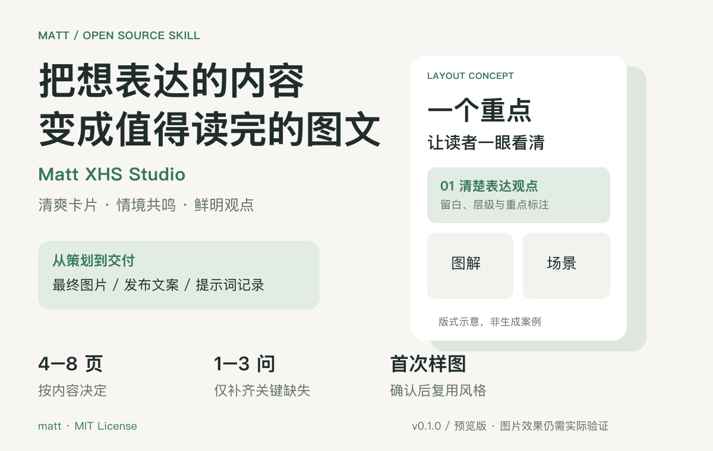
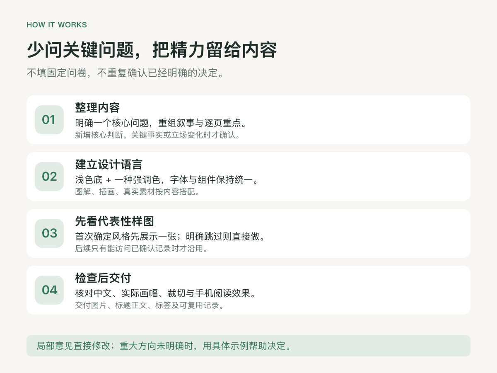
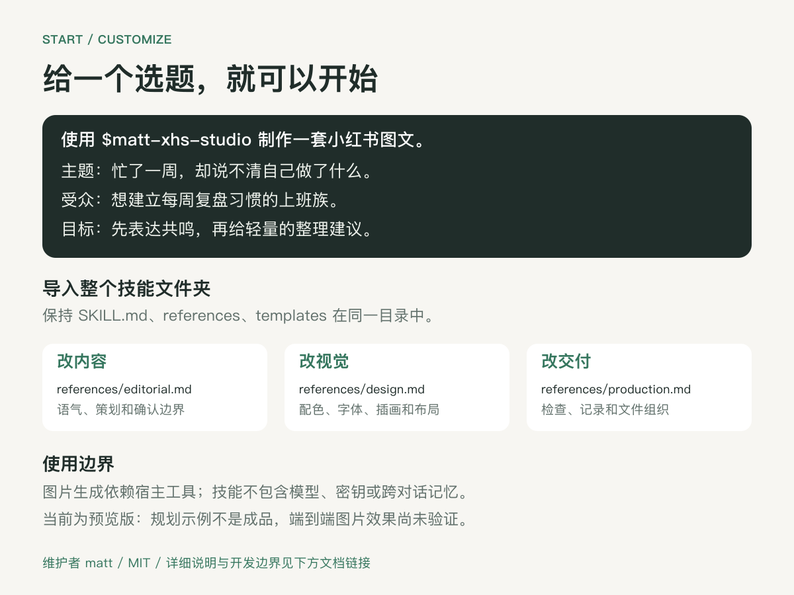

# Matt XHS Studio

[使用说明与文字版](docs/guide.md) · [技能入口](SKILL.md) · [规划示例](examples/planning-example.md) · [验收场景](examples/acceptance.md)

维护者 **matt** · **v0.1.0 预览版** · [MIT License](LICENSE) · [开发说明](DEVELOPMENT.md)

README 图像为说明与版式示意，不是已生成的图文成品。开发过程接触过其他技能，非严格净室开发；具体边界和验证限制见开发说明。
